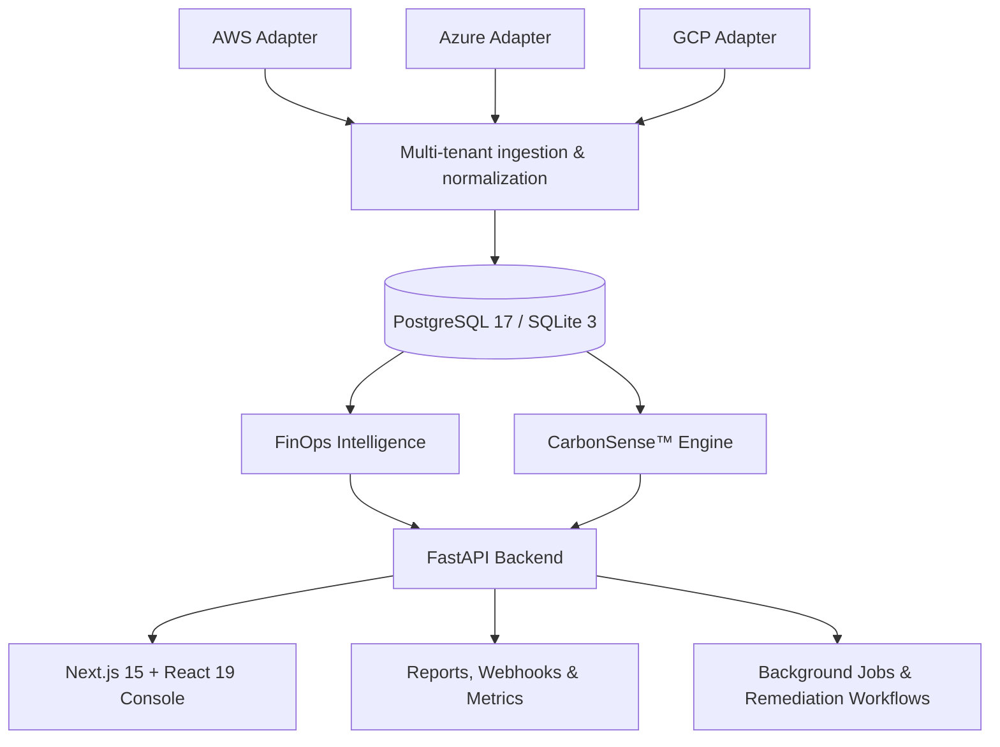

<div align="center">

# ☁️ CloudSense AI

### See Your Cloud. Understand Your Spend. Decarbonize Intelligently.

**Intelligent Cloud Cost · FinOps · Forecasting · Optimization · Carbon Intelligence**

[](https://www.python.org/)
[](https://fastapi.tiangolo.com/)
[](https://nextjs.org/)
[](https://www.typescriptlang.org/)
[](https://www.postgresql.org/)
[](LICENSE)

*A multi-cloud FinOps and sustainability intelligence platform built to connect cloud spending, operational decisions, and environmental impact in one place.*

</div>

---

## ✨ Why CloudSense AI?

Cloud environments can be expensive, complex, and difficult to govern consistently. CloudSense AI brings cost visibility, machine-learning-assisted analysis, optimization workflows, and carbon intelligence into one platform.

It is designed around a key principle: **every insight should be traceable to data, every sensitive action should be controlled, and simulated telemetry should never be mistaken for live cloud data.**

### At a glance

| Capability | What it does |
|---|---|
| 💸 **FinOps visibility** | Explore cloud costs by provider, service, time period, and organizational context. |
| 📈 **Cost forecasting** | Generate multi-horizon trend forecasts with evaluation metrics and confidence bounds. |
| 🚨 **Anomaly detection** | Identify unusual cost patterns and provide deterministic root-cause diagnostics. |
| 🎯 **Budgets & governance** | Track budget thresholds, deduplicated alerts, and mandatory cost-tag compliance. |
| 🌱 **CarbonSense™** | Estimate and classify greenhouse-gas emissions using documented regional factors and source-aware accounting. |
| 🛠️ **Optimization workflows** | Rank recommendations, explore what-if scenarios, and maintain a savings ledger. |
| 🔐 **Security & auditability** | Apply role-based access control, token revocation, tenant isolation, and audit logging. |
| 🧱 **Infrastructure FinOps** | Analyze Terraform plan diffs and Kubernetes idle-resource allocation. |
| 📄 **Executive reporting** | Produce database-reconciled PDF reports and sanitized CSV exports. |

---

## 🧭 Platform Architecture



### Architecture principles

- **One authoritative data layer:** dashboards, reports, simulations, and analytics should reconcile with persisted records.
- **Idempotent ingestion:** SHA-256-based duplicate checks and idempotency handling help prevent duplicate billing imports.
- **Multi-tenant isolation:** data access is scoped to the authenticated organization.
- **Read-first cloud integrations:** provider adapters are designed for credential validation and read-only ingestion.
- **Controlled remediation:** proposed changes require approval before execution and must have a rollback plan.
- **Observable operations:** health checks, metrics, structured audit events, and background-job visibility support troubleshooting.

---

## 🧠 Core Intelligence

### 💸 FinOps Intelligence

- Cost explorer with provider/service grouping and date filters
- Period-over-period cost analysis and data lineage
- Multi-horizon forecasts from **7 to 90 days**
- Forecast evaluation using **MAE, RMSE, and MAPE** where applicable
- **80% and 95%** forecast confidence bounds
- Isolation Forest-based anomaly detection
- Deterministic root-cause analysis and recommendation prioritization
- Persistent budgets, threshold alerts, and tag-compliance checks

### 🌱 CarbonSense™ — Cloud Sustainability

CloudSense™ connects cost optimization with environmental context.

- Greenhouse-gas accounting organized around **Scope 1, Scope 2, and Scope 3**
- Scope 2 market-based and location-based distinctions
- Regional grid-intensity factors referenced in the project specification: **EPA eGRID 2024** and **EEA 2023**
- Hardware wattage deltas for supported optimization scenarios
- Emissions budgets and carbon-aware recommendation priorities
- Source-aware reporting to distinguish estimates, assumptions, and reported data

> **Important:** emissions estimates depend on the quality of usage data, region mapping, emission factors, and calculation assumptions. They should not be interpreted as audited carbon disclosures without independent validation.

### 🛠️ Optimization & What-If Simulator

Explore trade-offs with four prioritization modes:

- `BALANCE` — balance competing priorities
- `COST` — emphasize financial savings
- `EMISSIONS` — emphasize emissions reduction
- `RISK_AVOIDANT` — favor risk-conscious recommendations

The simulator is designed for read-only scenario analysis. Remediation remains a controlled workflow, not an automatic production change.

### 🤖 AI FinOps Analyst & Reporting

- Natural-language analysis grounded in authorized backend tools
- Executive PDF digest generation
- Sanitized CSV exports
- Background report jobs and database reconciliation

The analyst should answer from available, authorized system data—not invented metrics or unsupported claims.

---

## 🗺️ Application Feature Map

| Route | Purpose |
|---|---|
| `/dashboard` | Executive KPIs, cost trends, provider breakdown, anomaly alerts |
| `/cloud-accounts` | AWS, Azure, and GCP connector configuration and sync status |
| `/costs` | Cost explorer, date filters, grouping, sanitized CSV export |
| `/forecast` | 7–90 day forecasts, confidence bounds, evaluation metrics |
| `/anomalies` | Anomaly review and impact analysis |
| `/rca` | Root-cause diagnostics and explanations |
| `/optimization` | Prioritized recommendations, what-if scenarios, savings ledger |
| `/iac` | Terraform plan diffs, policy checks, Kubernetes idle-resource analysis |
| `/carbon` | Scope 1/2/3 views, regional factors, emissions budgets |
| `/security` | Security and compliance findings |
| `/sla` | Service-level agreement and uptime tracking |
| `/budgets` | Budgets, spend aggregation, thresholds, burn rates |
| `/alerts` | Alert triage: new, in progress, resolved |
| `/assistant` | Grounded AI FinOps analyst |
| `/system` | Diagnostics, background jobs, remediation, webhooks |
| `/reports` | Executive PDF and CSV report generation |
| `/settings` | Workspace, user management, roles, audit logs |

---

## 🧰 Technology Stack

<table>
  <tr>
    <td><strong>Frontend</strong></td>
    <td>Next.js 15.4.6 · React 19.1.1 · TypeScript 5.8 · Tailwind CSS 4 · Recharts 2.15 · Framer Motion 12.4</td>
  </tr>
  <tr>
    <td><strong>Backend</strong></td>
    <td>Python 3.11 · FastAPI 0.116.1 · Pydantic 2.11 · SQLAlchemy 2.0</td>
  </tr>
  <tr>
    <td><strong>Data & ML</strong></td>
    <td>scikit-learn 1.7.1 · NumPy 2.3.2 · Pandas 2.3.2</td>
  </tr>
  <tr>
    <td><strong>Database & cache</strong></td>
    <td>PostgreSQL 17 · SQLite 3 · Redis 7</td>
  </tr>
  <tr>
    <td><strong>Reporting & security</strong></td>
    <td>ReportLab 4.4 · bcrypt 4.3 · JWT-based sessions · HMAC-SHA256 webhooks</td>
  </tr>
  <tr>
    <td><strong>Quality</strong></td>
    <td>Pytest 8.4.1 · reported 104 tests across 14 specialized suites</td>
  </tr>
</table>

---

## 🚀 Quick Start

### Prerequisites

- Python 3.11
- Node.js and npm compatible with the frontend project
- Git
- Docker Desktop for the containerized setup (optional)

### Option A — Docker Compose

> Recommended for evaluating the full multi-service setup, provided the repository includes the referenced Compose configuration.

```bash
git clone https://github.com/your-org/cloudsense-ai.git
cd cloudsense-ai
docker compose up --build
```

Open the services:

| Service | URL |
|---|---|
| Frontend | http://localhost:3000 |
| API documentation | http://localhost:8000/docs |
| Health check | http://localhost:8000/health |
| Prometheus metrics | http://localhost:8000/metrics |

**Repository note:** replace `your-org` in the clone URL with the actual GitHub organization or username before running it.

### Option B — Local development with SQLite

#### 1. Create and activate a virtual environment

```bash
python3.11 -m venv .venv
source .venv/bin/activate
```

On Windows PowerShell, activate it with:

```powershell
.venv\Scripts\Activate.ps1
```

#### 2. Install backend dependencies

```bash
python -m pip install --upgrade pip
pip install -r backend/requirements.txt
```

#### 3. Seed the demonstration database

```bash
bash scripts/seed.sh
```

The supplied project notes describe a deterministic demonstration dataset containing **120 resources and 90 days of telemetry**. Treat seeded telemetry as demonstration data, not as a live cloud-provider connection.

#### 4. Start the API

```bash
uvicorn backend.app.main:app --reload --port 8000
```

#### 5. Start the frontend in a second terminal

```bash
cd frontend
npm install
npm run dev
```

Visit **http://localhost:3000**.

> If a command fails, check that your local repository contains the referenced path and that your installed dependency versions match the project configuration.

---

## 🧪 Testing & Verification

Run the backend test suite from the repository root:

```bash
.venv/bin/pytest -v
```

Build the frontend for production:

```bash
cd frontend
npm run build
```

The project specification reports **104 passing backend tests across 14 suites**. Re-run the tests in your own checkout to confirm the current state; do not treat a previously reported result as proof that your current branch passes.

### Test coverage areas

- Billing import transactions, duplicate rejection, and idempotency
- Cost aggregation, data lineage, tenant boundaries, and CSV sanitization
- Budget CRUD, threshold transitions, alert deduplication, and tag governance
- Forecasting metrics, anomaly detection, and root-cause analysis
- Carbon accounting, regional factors, and carbon budgets
- Optimization scoring, simulator behavior, and savings ledger
- Authentication, RBAC, token revocation, and audit logs
- Multi-cloud connector validation and sync idempotency
- Terraform plan parsing, policy gates, and Kubernetes idle waste
- Health diagnostics, background jobs, metrics, and signed webhooks
- Report generation and formula-injection protection

---

## 🔐 Security & Trust Principles

Security and trustworthy reporting are foundational design goals.

| Principle | Implementation described in the project |
|---|---|
| **No fabricated live telemetry** | Without real provider credentials, connections must be clearly marked as simulated; `is_simulated: true` identifies simulated telemetry. |
| **Secret protection** | Credentials are masked in application views; raw private keys and tokens should not be exposed. |
| **Signed webhooks** | Outbound webhook signatures use HMAC-SHA256 and the `X-CloudSense-Signature` header. |
| **Human approval** | Remediation defaults to `PROPOSED`; state-changing actions require authorized approval and a rollback plan. |
| **CSV safety** | Exported cells beginning with formula-triggering characters are sanitized to reduce spreadsheet formula-injection risk. |
| **Tenant isolation** | Reads and writes are scoped to the authenticated `organization_id`. |
| **Session revocation** | JWT token identifiers can be revoked on logout. |
| **Auditability** | Structured audit records support review of relevant actions. |

**Before production deployment:** verify authentication and authorization paths, secret storage, tenant isolation, provider IAM permissions, database migrations, CORS, rate limits, dependency vulnerabilities, and all remediation paths. A feature description is not a substitute for a security audit.

---

## 👤 Demonstration Access

The project notes list the following seeded administrator account:

| Role | Email | Password |
|---|---|---|
| Platform Administrator | `admin@cloudsense.ai` | `CloudSense@123` |

These are **demonstration credentials only**. Confirm that the seed script creates this account before use. Never use these credentials in production; change or remove seeded accounts and rotate secrets before deploying.

Other roles described by the project:

- **FINOPS_ENGINEER** — manage cloud integrations and propose or approve permitted actions
- **AUDITOR** — review audit records and reports
- **VIEWER** — read-only dashboard and analytics access

Exact permissions should be confirmed against the current authorization implementation.

---

## 🧩 Delivery Roadmap — 13 Phases

The supplied project specification describes the following completed phases. Validate each against the current repository and test results before treating it as release evidence.

1. **Audit & Data Stabilization** — database baselines, chart-regression fixes, demo telemetry isolation, non-fabrication rules.
2. **Billing Import Engine** — transactional CSV ingestion, SHA-256 duplicate detection, idempotency, no partial writes.
3. **Cost Explorer & Data Lineage** — cost aggregation, period comparisons, sanitized CSV exports.
4. **Budgets, Alerts & Tag Governance** — persistent budgets, deduplicated alerts, mandatory-tag checks.
5. **Forecasting, Anomalies & RCA** — multi-horizon forecasts, confidence intervals, Isolation Forest, deterministic diagnostics.
6. **CarbonSense™ Sustainability** — source-aware emissions accounting and regional grid factors.
7. **Optimization, Simulator & Ledger** — recommendation scoring, read-only what-if analysis, savings ledger.
8. **AI Analyst & Executive Reports** — authorized data-grounded assistant and PDF/CSV reporting.
9. **Security, Identity & Collaboration** — RBAC, token revocation, tenant isolation, audit trails.
10. **Multi-Cloud Ingestion Connectors** — AWS, Azure, and GCP adapter architecture.
11. **Background Jobs & Observability** — scheduled tasks, health checks, Prometheus metrics, signed webhooks, controlled remediation.
12. **Shift-Left IaC & Container FinOps** — Terraform plan analysis, CI/CD policy gates, Kubernetes idle-resource analysis.
13. **Release Readiness & Hardening** — container hardening, repository secret scanning, deterministic seeding, reported test verification.

---

## 🛣️ Suggested Next Steps

Potential follow-on work for a production-oriented release:

- Validate live AWS, Azure, and GCP integrations in isolated test accounts
- Add documented environment-variable templates and secret-management guidance
- Verify database migrations and backup/restore procedures
- Add CI workflows for backend tests, frontend builds, linting, and dependency/security scans
- Document forecast model assumptions, baselines, and limitations
- Validate emission-factor provenance, units, geography mapping, and calculation methodology
- Exercise tenant-isolation and authorization tests against adversarial cases
- Document deployment, rollback, observability, and incident-response procedures

---

## 🤝 Contributing

Contributions, issue reports, and practical suggestions are welcome.

1. Fork the repository.
2. Create a focused branch: `git checkout -b feature/your-feature`.
3. Make changes with tests and relevant documentation.
4. Run backend tests and the frontend production build.
5. Open a pull request explaining the problem, solution, and verification performed.

Please avoid committing credentials, private billing data, real cloud secrets, or unreviewed production remediation logic.

---

## 📜 License

This project is described as licensed under the **MIT License**. See [`LICENSE`](LICENSE) in the repository for the full terms.

---

<div align="center">

### 🌍 Make cloud decisions that make financial and environmental sense.

**CloudSense AI** — visibility for your cloud, accountability for your spend, and context for your carbon impact.

<sub>Built for thoughtful FinOps, transparent analytics, and safer cloud operations.</sub>

</div>
