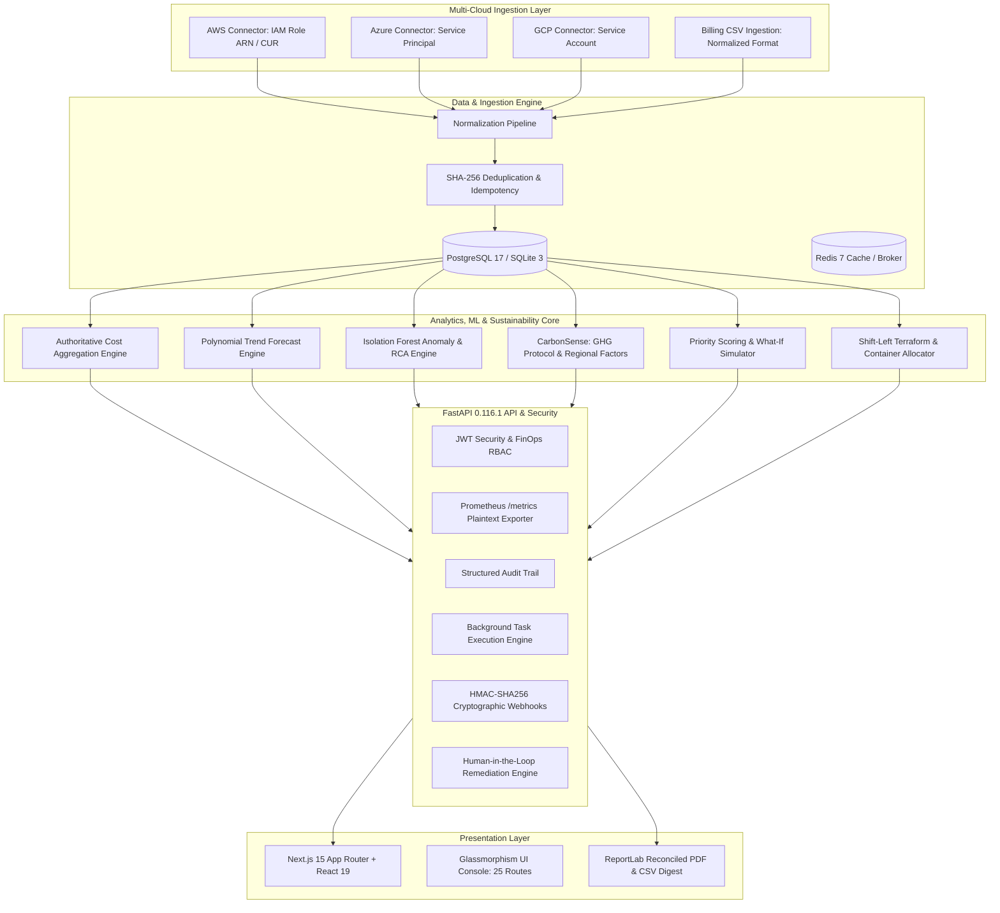

# CloudSense AI — Architecture and Technical Design

## 1. System Architecture

CloudSense AI provides unified cloud financial management (FinOps), machine learning predictive analytics, automated remediation, and CarbonSense™ environmental sustainability tracking across multi-cloud environments (AWS, Azure, GCP).

---

## 2. Architectural Layers

### 2.1 Multi-Cloud Ingestion Layer
- **Pluggable Connectors (`backend/app/providers/`)**:
  - AWS: Validates 12-digit IAM Role ARNs (`arn:aws:iam::\d{12}:role/...`) and multi-tenant External IDs.
  - Azure: Validates Service Principal Tenant UUIDs, Client UUIDs, and Subscription IDs.
  - GCP: Validates Project ID slugs and Service Account emails.
- **Deduplication Invariant**: Every billing record import calculates `sha256(org:provider:date:resource:amount)` to guarantee zero duplicate row writes upon replay.

### 2.2 Analytics & ML Engine
- **Forecasting**: Chronological time-series regression with 80% and 95% dynamic confidence intervals, non-negative clamping, and real-time MAE/RMSE calculation against baseline models.
- **Anomaly Detection**: Unsupervised Isolation Forest evaluating residual deviations from median envelopes, calculating financial impact, and performing deterministic Root Cause Analysis (RCA).
- **CarbonSense™ Sustainability Engine**: Maps compute and storage power consumption ($kWh$) to regional grid emission intensity factors ($gCO_2e/kWh$) from EPA eGRID 2024 and EEA 2023. Categorizes emissions into GHG Protocol Scope 1, Scope 2 (market/location-based), and Scope 3.

### 2.3 Shift-Left IaC & Container FinOps
- **Terraform Plan Diff Analyzer**: Evaluates `terraform show -json` output pre-deployment. Computes cost delta ($\Delta \$ / \text{mo}$) and carbon delta ($\Delta kgCO_2e / \text{mo}$) using benchmark catalog rates. Enforces CI/CD policy gates (`PASSED`, `WARNING`, `BLOCKED`).
- **Kubernetes Cost Allocation**: Measures CPU/Memory requests vs. utilization to determine **Allocated Application Cost** vs. **Idle Overprovisioned Waste Cost**, and tracks cluster efficiency scores across namespaces.

### 2.4 Security, RBAC & Observability
- **Role-Based Access Control**:
  - `ADMIN`: Full system configuration, connectors, jobs, users, and audit logs.
  - `FINOPS_ENGINEER`: Connector configuration, manual syncs, remediation action approval.
  - `AUDITOR`: Read-only access to audit trail, executive reports, and compliance.
  - `VIEWER`: Read-only access to operational dashboards.
- **JWT Session Security**: Cryptographic JTI tracking in `RevokedToken` ensures immediate token invalidation upon `POST /api/auth/logout`.
- **Cryptographic Webhooks**: Outbound payloads are authenticated with HMAC-SHA256 signatures (`X-CloudSense-Signature: sha256=...`).
- **Human-in-the-Loop Safeguards**: Remediation proposals strictly default to `PROPOSED`; state mutating execution mandates approval by `ADMIN` or `FINOPS_ENGINEER` and requires an automated or documented `rollback_plan`.
